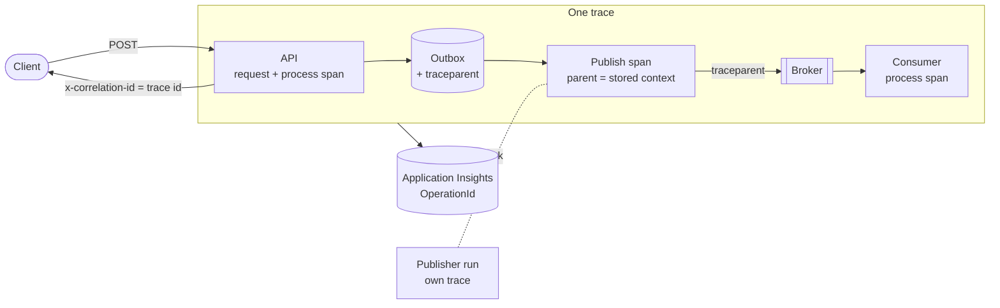

# OpenTelemetry observability in .NET — a working playbook

Traces, metrics and logs with OpenTelemetry and Application Insights, for a system of APIs, workers and
function apps that talk through HTTP, queues and an outbox — where support has one id from an error
message and needs everything that request caused. A small library, tests against in-memory exporters, a
runnable demo, and documentation that explains each design decision and how to apply it to your own
solution.



## Why

Adding the OpenTelemetry packages takes an hour. Getting telemetry you can rely on takes longer,
because:

- **asynchronous hops lose the trace.** An outbox publisher or a queue consumer starts its own trace, and
  the id the client got back finds nothing past the database;
- **a hand-built correlation id drifts.** A second id, stored and forwarded by hand, is missing the first
  time someone forgets it — while the trace id is already everywhere;
- **the exporter's defaults change.** One upgrade capped traces at five per second; another default drops
  every log line of a sampled-out trace;
- **silence looks like health.** A worker can run for weeks while its exporter sends nothing, and no alert
  fires on the absence of errors;
- **sampled numbers are wrong numbers.** Counts from traces or logs are off by the sampling ratio; alerts
  on them are too.

This playbook covers those cases.

## What it shows

| Topic | Read | See it in code |
|---|---|---|
| The packages, what each signal is for, the conventions | [architecture.md](docs/architecture.md) | [ObservabilityServiceCollectionExtensions.cs](src/Observability/ObservabilityServiceCollectionExtensions.cs) |
| W3C trace context, parent-based sampling, baggage that stays inside | [tracing-and-w3c-context.md](docs/tracing-and-w3c-context.md) | [ScopedBaggagePropagator.cs](src/Observability/ScopedBaggagePropagator.cs) |
| The trace id as correlation id, on every response, a 500 included | [correlation-ids-and-headers.md](docs/correlation-ids-and-headers.md) | [CorrelationIdMiddleware.cs](src/Observability.AspNetCore/CorrelationIdMiddleware.cs), [GatewayTransactionIdMiddleware.cs](src/Observability.AspNetCore/GatewayTransactionIdMiddleware.cs) |
| Business process names as spans, baggage, columns and exact metrics | [process-logging.md](docs/process-logging.md) | [ProcessTracer.cs](src/Observability/ProcessTracer.cs), [BaggageToTagsProcessor.cs](src/Observability/BaggageToTagsProcessor.cs) |
| An outbox and messages that keep the request's trace | [outbox-and-messaging-correlation.md](docs/outbox-and-messaging-correlation.md) | [OutboxPublisher.cs](src/Observability.Outbox/OutboxPublisher.cs), [MessagingTraceContext.cs](src/Observability/Messaging/MessagingTraceContext.cs) |
| Message templates, source-generated log methods, scopes | [structured-logging-and-scopes.md](docs/structured-logging-and-scopes.md) | [Log.cs](src/Observability/Log.cs) |
| Process metrics, metrics bundles, expected dependency responses | [metrics.md](docs/metrics.md) | [ProcessMetricsListener.cs](src/Observability/Metrics/ProcessMetricsListener.cs), [MetricsBundle.cs](src/Observability/Metrics/MetricsBundle.cs) |
| The Application Insights exporter with its defaults pinned, and managed identity sign-in | [azure-monitor-exporter.md](docs/azure-monitor-exporter.md) | [AzureMonitorDefaults.cs](src/Observability.AzureMonitor/AzureMonitorDefaults.cs), [AzureMonitorCredential.cs](src/Observability.AzureMonitor/AzureMonitorCredential.cs) |
| What to cut, what to sample, what never to sample | [sampling-and-cost.md](docs/sampling-and-cost.md) | [AzureMonitorDefaults.cs](src/Observability.AzureMonitor/AzureMonitorDefaults.cs) |
| A heartbeat that proves the telemetry pipeline works | [telemetry-heartbeat.md](docs/telemetry-heartbeat.md) | [TelemetryHeartbeat.cs](src/Observability/Heartbeat/TelemetryHeartbeat.cs) |
| Isolated-worker function apps and Service Bus triggers | [azure-functions.md](docs/azure-functions.md) | [ServiceBusTraceContextMiddleware.cs](src/Observability.Functions/ServiceBusTraceContextMiddleware.cs) |
| KQL for one correlation id, failures by process, ingestion by table | [kql-queries.md](docs/kql-queries.md) | — |
| Alerts with useful dimensions, summary rules, dashboards as a funnel | [alerts-and-dashboards.md](docs/alerts-and-dashboards.md) | — |
| Raw HTTP payloads in append blobs, found by trace id, best effort | [raw-payload-archive.md](docs/raw-payload-archive.md) | [PayloadArchiveMiddleware.cs](src/Observability.PayloadArchive/PayloadArchiveMiddleware.cs), [PayloadArchiveWriter.cs](src/Observability.PayloadArchive/PayloadArchiveWriter.cs) |
| Testing telemetry as behaviour, against in-memory exporters | [testing.md](docs/testing.md) | [TelemetryHarness.cs](tests/Observability.Tests/TelemetryHarness.cs) |

Then: [get started](docs/getting-started.md),
[apply it to your own solution](docs/applying-to-your-solution.md), and read the
[pitfalls](docs/pitfalls.md) first.

## Quick start

Requires the .NET 10 SDK.

```shell
dotnet test Observability.slnx
dotnet run --project samples/OrderDemo --urls http://localhost:5199
```

Post an order to `/orders` and the demo prints one line per span: the request, the outbox publish and the
consumer share the trace id returned in `x-correlation-id`. Set `APPLICATIONINSIGHTS_CONNECTION_STRING` or
`OTEL_EXPORTER_OTLP_ENDPOINT` to send the telemetry to a real backend. See
[getting started](docs/getting-started.md).

## Layout

```text
src/
  Observability/               Options, process spans, baggage rules, propagation, metrics, heartbeat
  Observability.AspNetCore/    Request spans, x-correlation-id, the gateway id, process spans per endpoint
  Observability.Functions/     Isolated-worker middleware: Service Bus trace context, process spans
  Observability.Outbox/        An outbox that stores and restores the trace context of each message
  Observability.AzureMonitor/  The Application Insights exporter with pinned defaults and managed identity
  Observability.PayloadArchive/ Raw inbound and outbound HTTP payloads in append blobs, with a health check
samples/
  OrderDemo/                   An API, an outbox and a consumer in one process
tests/
  Observability.Tests/         Every behaviour above, against in-memory exporters and a test server
tools/                         Leak check and documentation link check, run in CI
```

## Related playbooks

From the same monorepo, each on its own:

- [Domain-Driven Design in .NET](https://github.com/iverburgh/ddd-dotnet-playbook) — bounded
  contexts, domain events and the outbox whose messages this playbook keeps in one trace.
- [HTTP resilience in .NET](https://github.com/iverburgh/dotnet-http-resilience-playbook) —
  retries, timeouts and outbound throttling, with their own metrics and logs.
- [Circuit breakers on Azure Functions](https://github.com/iverburgh/azure-functions-circuit-breaker-playbook) —
  a breaker shared by every instance, and the telemetry that shows why it opened.
- [Azure App Configuration](https://github.com/iverburgh/azure-app-configuration-playbook) —
  configuration as code, including sampling ratios and log levels per environment.
- [Entra ID app registrations as code](https://github.com/iverburgh/entra-app-registrations-as-code-playbook) —
  app registrations, roles and managed identities as code, such as the one that publishes telemetry.
- [Copilot on Azure DevOps](https://github.com/iverburgh/copilot-azure-devops-playbook) —
  instructions, skills and agents for a repository like this one.
- [Path filters on Azure DevOps](https://github.com/iverburgh/azure-devops-path-filter-playbook) —
  build and deploy only what a change touches.
- [Renovate on Azure DevOps](https://github.com/iverburgh/renovate-azure-devops-playbook) —
  automated dependency updates.

## License

[MIT](LICENSE)
