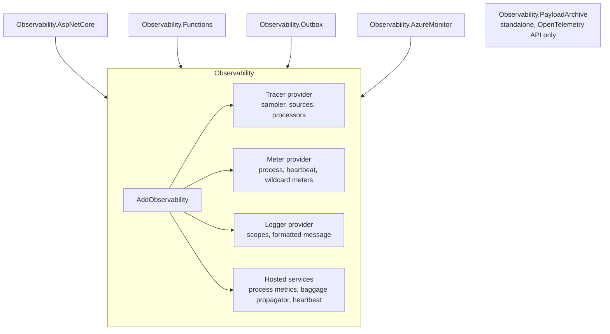
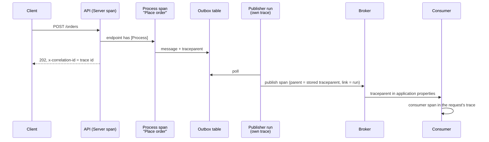

# Architecture

`AddObservability()` sets up OpenTelemetry tracing, metrics and logging for a .NET host with the same
conventions in every service: one service name, one sampler, one set of baggage rules, one way to name a
business process. Small add-on packages connect ASP.NET Core, Azure Functions, an outbox and Application
Insights. This page shows what goes where and why.

## The packages

| Package | Adds | Code |
|---|---|---|
| `Observability` | Options, `ProcessTracer`, baggage-to-tags, expected dependency responses, scoped baggage propagation, metrics bundles, the heartbeat, trace context for messages | [ObservabilityServiceCollectionExtensions.cs](../src/Observability/ObservabilityServiceCollectionExtensions.cs) |
| `Observability.AspNetCore` | Request spans without health probes, `x-correlation-id`, the gateway transaction id, a process span per endpoint | [AspNetCoreObservabilityExtensions.cs](../src/Observability.AspNetCore/AspNetCoreObservabilityExtensions.cs) |
| `Observability.Functions` | Joining a Service Bus–triggered invocation to the message's trace, a process span per function | [FunctionsObservabilityExtensions.cs](../src/Observability.Functions/FunctionsObservabilityExtensions.cs) |
| `Observability.Outbox` | An outbox that stores the trace context with each message and publishes it in the original trace | [OutboxPublisher.cs](../src/Observability.Outbox/OutboxPublisher.cs) |
| `Observability.AzureMonitor` | The Application Insights exporter with every cost-relevant default pinned, and managed-identity sign-in | [AzureMonitorDefaults.cs](../src/Observability.AzureMonitor/AzureMonitorDefaults.cs) |
| `Observability.PayloadArchive` | Raw inbound and outbound HTTP payloads in Azure append blobs, one per exchange, found by trace id; best effort, with a degraded-only health check. Does not need the core: it reads the current activity | [PayloadArchiveServiceCollectionExtensions.cs](../src/Observability.PayloadArchive/PayloadArchiveServiceCollectionExtensions.cs) |

The core has no exporter. The host picks one: Application Insights, an OTLP collector, or — in tests — the
in-memory exporter. Nothing in the core knows which.

## One request, end to end

Everything the request caused — the process, the publish, the consumer and whatever it calls — has the
trace id the client got back in `x-correlation-id`. The publisher's own work, one run every few seconds,
is a separate trace, linked from each publish span. See
[outbox and messaging correlation](outbox-and-messaging-correlation.md).

## What each signal is for

| Signal | Answers | Survives sampling | Read |
|---|---|---|---|
| Traces | What happened in *this* request, across services, in what order, how long each step took | No: a sampled-out trace is gone | [tracing](tracing-and-w3c-context.md) |
| Logs | What the code decided and why, with the business identifiers in scope | Yes, unless you let the exporter drop them | [structured logging](structured-logging-and-scopes.md) |
| Metrics | How often, how fast, how many failed — exactly, for every request | Yes: measured before any sampling | [metrics](metrics.md) |
| Process names | Which *business* process a span, log line or metric belongs to | Yes, as baggage, tags and a metric dimension | [process logging](process-logging.md) |

Counting from traces or logs gives wrong numbers as soon as you sample. Count with metrics; explain with
logs; follow one case with traces. See [sampling and cost](sampling-and-cost.md).

## Conventions

- **The trace id is the correlation id.** No separate id to generate, store and forward; every backend
  already indexes the trace id. See [correlation ids and headers](correlation-ids-and-headers.md).
- **A process name is functional.** "Place order", not `OrderController.Post`: a support engineer and a
  product owner can both read it, and it stays stable when the code moves.
- **Baggage is allow-listed.** It crosses service boundaries; only known keys become columns, and only
  internal hosts receive it.
- **Defaults are explicit.** The exporter's defaults changed between versions before; every value that
  changes cost or visibility is set in code. See [the Azure Monitor exporter](azure-monitor-exporter.md).
- **Telemetry about telemetry.** A heartbeat proves the pipeline works; silence is not a success. See
  [telemetry heartbeat](telemetry-heartbeat.md).

## Not included

- **Browser telemetry.** A single-page app can send traces too, but it needs its own sampling, consent
  and privacy decisions.
- **A collector.** An OpenTelemetry Collector can do tail sampling, redaction and fan-out; this playbook
  exports directly and keeps the processing in the service. Add a collector when you need those features.
- **A database instrumentation choice.** Add `AddSqlClientInstrumentation()` or Entity Framework
  instrumentation on the builder `AddObservability` returns; the conventions here apply unchanged.
