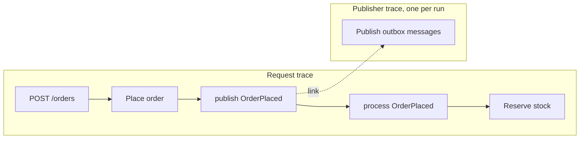

# Outbox and messaging correlation

The transactional outbox writes an integration message in the same database transaction as the change
that caused it; a publisher sends it later. That "later" breaks the trace: the publisher runs on a timer,
long after the request span ended, in a trace of its own. Without care, the consumer of the message ends up
in the publisher's trace and the request's `x-correlation-id` finds nothing past the database.

For the outbox pattern itself, see the
[Domain-Driven Design playbook](https://github.com/iverburgh/ddd-dotnet-playbook/blob/main/docs/outbox-pattern.md).
This page is about the telemetry.

## Store the trace context with the message

`OutboxWriter.EnqueueAsync` stores `Activity.Current.Id` — the W3C `traceparent` — and the trace state with
each message:

```sql
TraceParent  varchar(55)  NULL,
TraceState   varchar(512) NULL
```

That is all you need. Do not add a separate correlation id or process id column: the trace id is the
correlation id, and the process baggage of the request is in the trace.

Code: [OutboxMessage.cs](../src/Observability.Outbox/OutboxMessage.cs).

## Two traces, linked



- **One trace per publisher run.** `StartRootProcess("Publish outbox messages")`, tagged with the batch
  size. An empty poll creates no span at all: a trace every few seconds that says "nothing to do" is noise
  and cost.
- **One producer span per message, in the request's trace.** Its parent is the stored `traceparent`; it
  links to the run. Its `traceparent` goes into the outgoing message, so the consumer continues the
  request's trace.

The request's `x-correlation-id` now finds the publish and everything the consumer did. The run's trace
shows what one run did, with a link to each message's request.

## Parent or link

Some teams make the publish span a child of the run and only *link* to the stored context. Both are
valid; they answer different questions.

| `Outbox:TraceMode` | Publish span parent | Consumer continues | Best for |
|---|---|---|---|
| `Parent` (default) | the stored request context | the request's trace | following one business case end to end with one id |
| `Link` | the publisher run | the run's trace | very high fan-out, where one request causes thousands of messages and one trace would be unreadable |

With `Link`, the request's trace ends at the database. The consumer is reachable only through the link,
and an alert or a support search on `x-correlation-id` will not find it. Choose it deliberately.

Code: [OutboxPublisher.cs](../src/Observability.Outbox/OutboxPublisher.cs) (`StartPublishActivity`).

## Producer, not consumer

The publish span is `ActivityKind.Producer`. A producer span is a dependency in Application Insights, shown
as a send on the application map; a consumer span is a request. A publisher that marks its sends as
`Consumer` shows phantom incoming requests on the publisher and no outgoing edge to the broker.

## When the span is not recorded

If nothing listens to the outbox source — tracing disabled, or a sampler that drops it — there is no
publish span to inject. The publisher then writes the stored `traceparent` and `tracestate` to the message
unchanged, so the consumer still lands in the request's trace.

## Failures

A message that fails to send:

- sets `Error` on its publish span, with the exception;
- counts in `outbox.messages.failed`, by message type;
- increments `FailedAttempts` on the message and stays pending;
- does not stop the other messages in the batch.

The run's process span is `Error` if any message failed, so `process.completed` with
`process.name = Publish outbox messages` and `process.result = error` is the alert signal.

## Metrics

| Instrument | Unit | Tags | Use |
|---|---|---|---|
| `outbox.messages.published` | messages | `outbox.message_type` | throughput |
| `outbox.messages.failed` | messages | `outbox.message_type` | alert |
| `outbox.message.age` | seconds | `outbox.message_type` | time from commit to publish: the delay a consumer sees |

A growing age with no failures means the publisher is too slow or not running. Alert on both.

## Logs

Each publish runs in a log scope with `MessageId` and `MessageType`. Every log line the sender writes —
retries, the broker's errors — has those columns.

## Messages without an outbox

Code that sends to a broker directly uses the same helpers:

```csharp
MessagingTraceContext.Inject(Activity.Current, message.ApplicationProperties);

using var consumer = MessagingTraceContext.StartConsumerActivity(source, "process OrderPlaced", message.ApplicationProperties);
```

`StartConsumerActivity` starts a consumer span in the producer's trace. If the current span — a trigger,
a processor loop — is in another trace, it becomes a link and the span is tagged
`messaging.trace.reparented = true`. Code:
[MessagingTraceContext.cs](../src/Observability/Messaging/MessagingTraceContext.cs).

The Azure Service Bus SDK writes `Diagnostic-Id` itself when it sends inside a span. Writing `traceparent`
explicitly makes the contract visible and independent of the SDK version.
