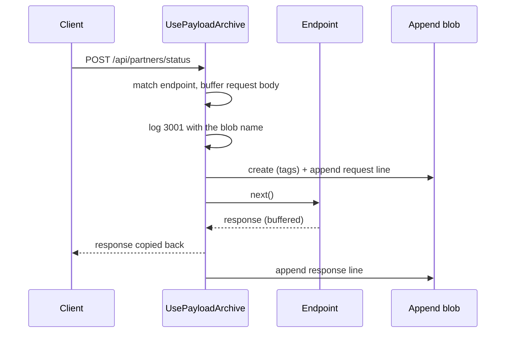

# Raw payload archive

Some integrations need the exact bytes a partner sent or received: to replay a message, to settle a
dispute, to debug a parser. Logs are the wrong place for that. They are expensive per gigabyte, searchable
by everyone with read access to the workspace, and truncated above a size limit.

Put raw payloads in blob storage and log only a pointer. `Observability.PayloadArchive` does that for HTTP:
it writes the raw request and response of inbound requests and outgoing calls to Azure append blobs, one
blob per exchange, found by trace id. Every storage call is best effort: an outage costs a warning, never
a request.

## Use it

```csharp
builder.Services.AddPayloadArchive(builder.Configuration);
builder.Services.AddHttpClient("carrier-a", client => client.BaseAddress = new Uri("https://carrier-a.example"))
    .AddPayloadArchive("carrier-a-archive");

var app = builder.Build();
app.UsePayloadArchive();   // before UseExceptionHandler: the archived response is the one the client got
app.UseExceptionHandler();
app.UseObservability();
```

```json
"PayloadArchive": {
  "ServiceUri": "https://my-account.blob.core.windows.net",
  "WriteTimeout": "00:00:05",
  "Endpoints": [
    {
      "PathPrefix": "/api/partners",
      "ExcludedPathSegments": [ "health", "files" ],
      "ContainerName": "partner-archive",
      "WriteAfterResponse": true
    },
    { "PathPrefix": "/api", "ContainerName": "api-archive" }
  ],
  "RedactedHeaders": [ "X-Partner-Token" ],
  "RedactedQueryParameters": [ "token" ]
}
```

| Setting | Meaning |
|---|---|
| `ServiceUri` | The blob endpoint, HTTPS. Read once at start-up; everything else reloads with the configuration. |
| `WriteTimeout` | The longest one record write may take, retries included: 100 ms to 1 minute, default 5 seconds. |
| `Endpoints[].PathPrefix` | Matched per segment and case-insensitively: `/api/orders` matches `/API/Orders/42`, not `/api/orders-report`. `/` matches everything. The first match wins. |
| `Endpoints[].ExcludedPathSegments` | Segments below the prefix that are never archived, such as `health`. Final: a later endpoint does not pick the path up. |
| `Endpoints[].ContainerName` | One container per endpoint, so each can have its own access and retention. |
| `Endpoints[].WriteAfterResponse` | Write both records after the response is sent: no added latency, but nothing is archived if the process dies mid-request. |
| `RedactedHeaders`, `RedactedQueryParameters` | Added to the built-in lists below. |

Validation runs at start-up and stops the host on a missing URI, a container name Azure would reject, or a
prefix that can never match because an earlier one covers it. Outgoing clients name their container in
code; the outbound handler has no `WriteAfterResponse`, because the caller is waiting for the response anyway.

## What happens per exchange



1. The path filter picks the endpoint. No match: the request passes through untouched.
2. The request body is buffered with `EnableBuffering`, so the endpoint still reads it.
3. The blob is named and tagged, and the pointer is logged while the request span is current.
4. The request line is written **before** the endpoint runs. A request that crashes the process is still
   on disk.
5. The response body is buffered and copied to the client.
6. The response line, with status, duration and the exception type if the endpoint threw, is appended to
   the same blob.

With `WriteAfterResponse`, steps 4 and 6 run in `HttpResponse.OnCompleted`, after the last byte has been
sent. The outbound `DelegatingHandler` does the same around `SendAsync`.

## Layout

```text
{container}/{yyyy}/{MM}/{dd}/{traceId}/{guid}.jsonl
```

| Part | Why |
|---|---|
| Date folders, in UTC | Lifecycle rules and manual clean-up by day; listing one day is cheap. |
| Trace id | Everything one request stored is in one folder, found with the `x-correlation-id`. `no-trace` when there is no current activity. |
| A new GUID per file | No overwrites when one trace stores several exchanges. |
| JSON Lines | One record per line, appendable, readable with any tool. Content type `application/x-ndjson`. |

Each blob holds two lines, the request and the response, with the context needed to understand them
without the logs:

```json
{"direction":"inbound","phase":"request","timestamp":"2026-01-01T12:00:00+00:00","traceId":"0af7651916cd43dd8448eb211c80319c","spanId":"b7ad6b7169203331","method":"POST","url":"https://example.com/api/partners/status?code=[redacted]","clientIp":"203.0.113.10","headers":{"Authorization":"[redacted]","Content-Type":"application/json"},"contentType":"application/json","bodyEncoding":"text","body":"{\"status\":\"delivered\"}"}
{"direction":"inbound","phase":"response","timestamp":"2026-01-01T12:00:00.0124+00:00","traceId":"0af7651916cd43dd8448eb211c80319c","spanId":"b7ad6b7169203331","statusCode":202,"durationMs":12.4,"headers":{"Content-Type":"application/json"},"contentType":"application/json","bodyEncoding":"text","body":"{\"accepted\":true}"}
```

| Field | Notes |
|---|---|
| `direction`, `phase` | `inbound` or `outbound`; `request` or `response`. |
| `traceId`, `spanId` | Inbound: the request span. Outbound: the caller's span; the client span is created further down. |
| `url` | Absolute, with `code`, `sig` and `access_token` values redacted and the fragment dropped. |
| `headers` | All of them, repeated values joined with `, `. Sensitive values become `[redacted]`; the name stays, because "an `Authorization` header was sent" is what you look for after a 401. |
| `statusCode`, `durationMs`, `error` | Response only. `error` is the exception type, never its message: messages can contain payload data. |
| `bodyEncoding`, `body` | `text` for `text/*`, JSON, XML and form content that decodes **strictly** in its charset; `base64` for everything else, invalid text included. A lenient decoder would replace bad bytes and lose the original for good. |

Built-in redacted headers: `Authorization`, `Proxy-Authorization`, `Cookie`, `Set-Cookie`, `X-Api-Key`,
`Api-Key`, `Ocp-Apim-Subscription-Key`, `X-Functions-Key`. Bodies are never redacted; that is what the
container's access control is for.

One record can be larger than the 4 MiB one Append Block call accepts. The writer splits it into blocks
and appends them in order, each with an append-position condition: a retried block that already landed
fails instead of being written twice. After any failed write the blob is left alone, because the next
line would be glued to half a record. A reader must still tolerate a partial last line.

## Find it from the telemetry

The archive logs one line per exchange, before the first write, while the request span is current:

```csharp
[LoggerMessage(EventId = 3001, Level = LogLevel.Information, Message = "Archiving {Direction} {Method} payload as {Container}/{BlobName}")]
public static partial void Archiving(ILogger logger, string direction, string method, string container, string blobName);
```

The log line is in the trace; the blob name finds the bytes.

| Event | Level | When |
|---|---|---|
| 3001 | Information | The pointer: container and blob name of an exchange. |
| 3002 | Warning | A write failed or timed out. The request continues. |
| 3003 | Warning | A body could not be read, for example a request above the size limit. The exchange is not archived. |
| 3004 | Warning | A configuration refresh made the options invalid. Nothing is archived until it is fixed. |

The storage calls themselves run in a `SuppressInstrumentationScope`: otherwise every archived trace would
show two or three blob dependencies that tell you nothing.

## Find it without the telemetry

Blob index tags make payloads searchable without opening them:

| Tag | Example |
|---|---|
| `traceId` | `0af7651916cd43dd8448eb211c80319c` (left out without a trace) |
| `direction` | `inbound` |
| `httpMethod` | `POST` |

`Find Blobs by Tags` returns every blob with that trace id across date folders. Query on the container, not
the account, so a role on the container is enough:

```csharp
var container = new BlobContainerClient(new Uri("https://my-account.blob.core.windows.net/partner-archive"), credential);
await foreach (var blob in container.FindBlobsByTagsAsync("\"traceId\"='0af7651916cd43dd8448eb211c80319c'"))
{
    Console.WriteLine(blob.BlobName);
}
```

When you know the day, browsing `yyyy/MM/dd/{traceId}/` works too. Tags are limited to ten per blob and are
visible to anyone who can read tags: no personal data in them.

## Best effort

The archive must never break or slow down the traffic it records.

| Failure | What happens |
|---|---|
| Storage down or slow | Each write gives up after `WriteTimeout`; warning 3002; the request continues. The blob client retries twice with short delays: the SDK defaults would hold a request for minutes. |
| Client hangs up | The write is bounded by `WriteTimeout`, not by `RequestAborted`: an aborted exchange is one you may want to read back. |
| A write failed halfway | The blob is marked broken and gets no more lines. |
| Invalid configuration after a refresh | Warning 3004, the health check reports degraded, requests pass through unarchived. Without the guard, `IOptionsMonitor.CurrentValue` throws on every request. |
| Endpoint throws | The response line records the exception type; the exception continues to the exception handler. |

With `WriteAfterResponse` the client never waits for storage at all. Without it, the request waits for the
request line, so a crash mid-request still leaves the payload behind. Choose per endpoint.

## Health check

`AddPayloadArchive` registers a `payload-archive` check. Per container, inbound and outbound, it checks that
the container is reachable and that blobs can be found by tag, at container scope. It reports **degraded,
never unhealthy**: a storage outage must not take an instance out of the load balancer. It writes nothing,
so it also works on an immutable container, where a probe blob could never be deleted.

## Protect it

- A separate storage account or container, with access for the application's identity and a small group
  that reads. Not the same access as the logs.
- Role assignments **on the container**, not the account. The writer needs to read container properties,
  create and append blobs, and read, write and filter blob index tags: Storage Blob Data Owner scoped to
  the container, or a custom role with just those data actions. Storage Blob Data Contributor alone cannot
  set or query tags.
- Managed identities and RBAC only: no shared keys, no SAS, no public access. The store signs in with the
  registered `TokenCredential`, or `DefaultAzureCredential` when none is registered.
- A lifecycle rule that deletes after the retention you need, and not later.
- On an immutable container with a time-based policy, appends need protected append writes allowed. Test
  that on your account before relying on it.

## Azure Functions

An isolated-worker function app with ASP.NET Core integration runs the ASP.NET Core pipeline, so
`UsePayloadArchive` works unchanged. See [Azure Functions](azure-functions.md#raw-payload-archive).

## When not to

- Payloads you can rebuild from your own database. Store the identifiers instead.
- Every internal message. The outbox table already holds what you published; archive at the edges, where
  a partner is involved.
- Streams. Both bodies are buffered in full: server-sent events, large downloads and uploads, and clients
  that use `HttpCompletionOption.ResponseHeadersRead` lose their streaming and cost memory. Exclude those
  paths, or do not add the handler to those clients.
- Health probes and file endpoints. Exclude them with `ExcludedPathSegments`.

## Testing

`IPayloadArchiveStore` is the seam: four calls (create, append at an offset, check access, check tag query)
and a maximum block size. The tests use an in-memory store that enforces the append offset and a small block
size, so chunking is tested end-to-end without 4 MiB bodies. Register your own store before calling
`AddPayloadArchive` to replace the blob store; see [testing](testing.md#payload-archive).

## Cost

Blob storage in the cool tier costs a small fraction of log ingestion per gigabyte, and nothing per query
you do not run. Moving payloads out of logs is often the biggest single cut in a telemetry bill. See
[sampling and cost](sampling-and-cost.md).
